<h1>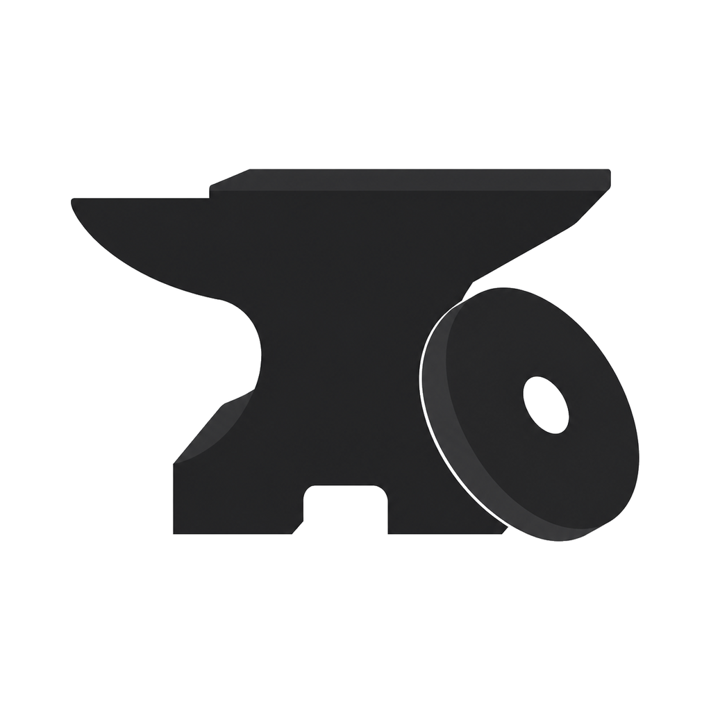 Forge: Training Journal</h1>

I’m building Forge, a workout journal for iOS and Android. Log sets, time and distance, organize routines and plans, and review your training history. Workouts stay on your device and work offline, without an account.

I use TypeScript, React Native and Expo, with native integrations for rest timers and numeric entry.

<p>
  <a href="https://rodrigomaia06.github.io/forge/"></a>
  <a href="https://rodrigomaia06.github.io/forge/privacy.html"></a>
  <a href="https://rodrigomaia06.github.io/forge/support.html"></a>
</p>

## What you can do

- **Record different kinds of training:** weight, reps, duration and distance, with workout types for strength, cardio, mobility and other activities.
- **Log a session:** exercise notes, set types, supersets, RPE, unilateral sets and rest timers. iOS supports a rest-timer Live Activity; Android has native timer notifications.
- **Prepare your training:** reusable standalone routines, plans and custom exercises, with searchable exercise variations.
- **Review progress:** workout history, calendar, trends, muscle heatmaps and daily measurements. Add the widgets you want to your dashboard.
- **Move your data:** portable JSON/`.forge` backups and shareable workouts, routines and plans, with selection and conflict review before saving.
- **Import another tracker:** Hevy, Strong and FitNotes Android/iOS CSV exports, plus Strive SQLite backups on iOS and Android. Strive history and active routines import together; uncertain exercise matches stay reviewable.

## Screenshots

| Dashboard                                                                                         | History                                                                                       | Live workout                                                                                            |
| ------------------------------------------------------------------------------------------------- | --------------------------------------------------------------------------------------------- | ------------------------------------------------------------------------------------------------------- |
| 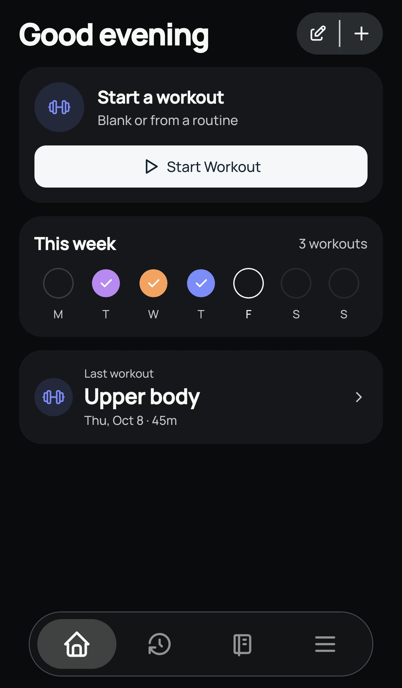 | 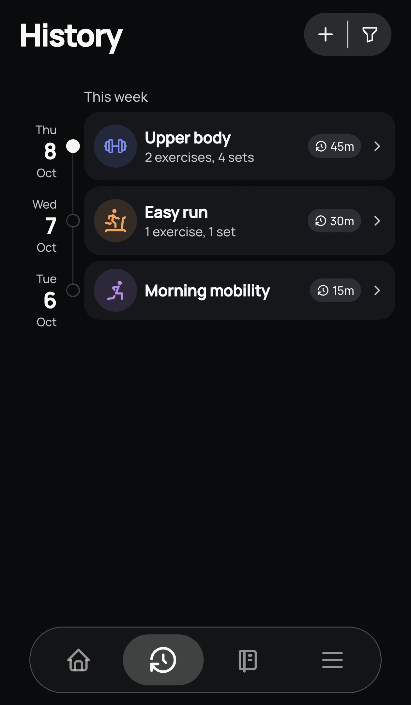 | 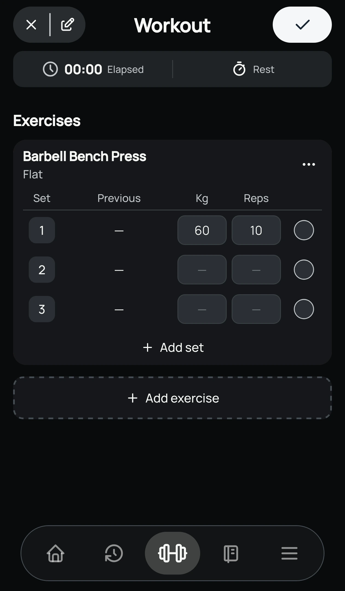 |

| Plans                                                                                     | Workout details                                                                                               | Exercise library                                                                                         |
| ----------------------------------------------------------------------------------------- | ------------------------------------------------------------------------------------------------------------- | -------------------------------------------------------------------------------------------------------- |
| 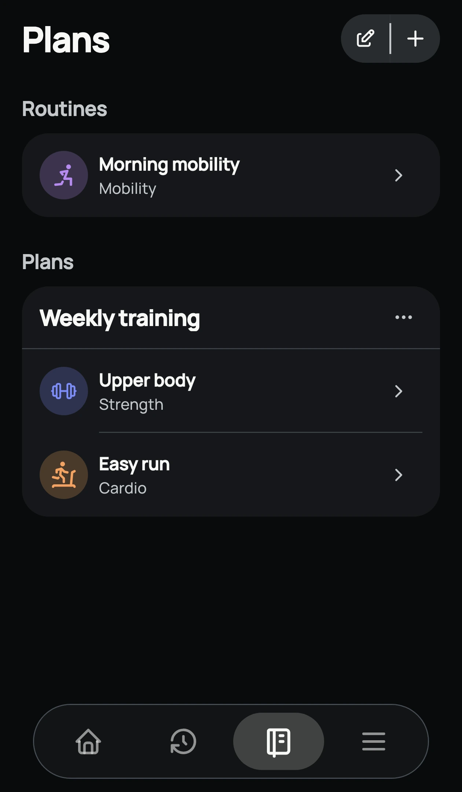 | 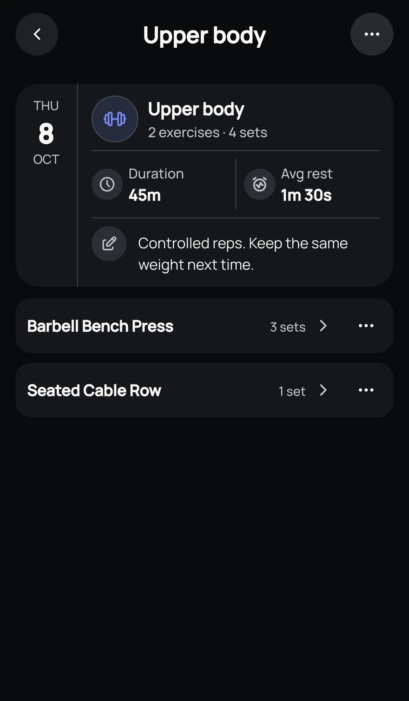 | 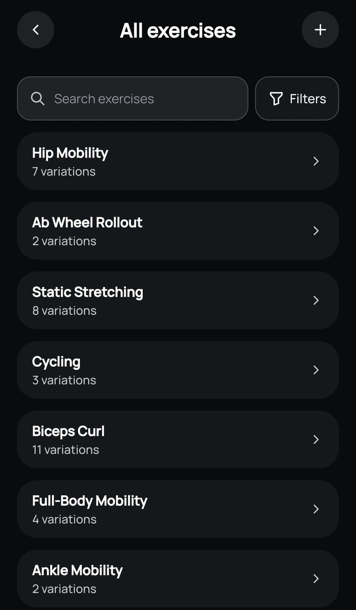 |

<details>
<summary>View Light theme</summary>

| Dashboard                                                                                           | History                                                                                         | Live workout                                                                                              |
| --------------------------------------------------------------------------------------------------- | ----------------------------------------------------------------------------------------------- | --------------------------------------------------------------------------------------------------------- |
| 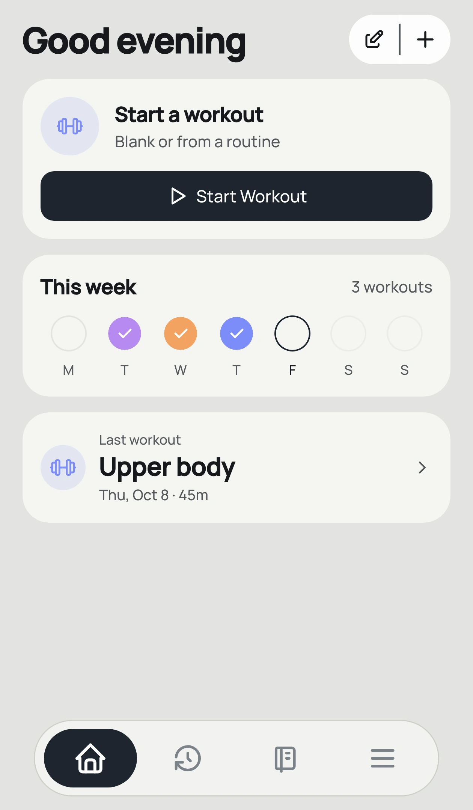 | 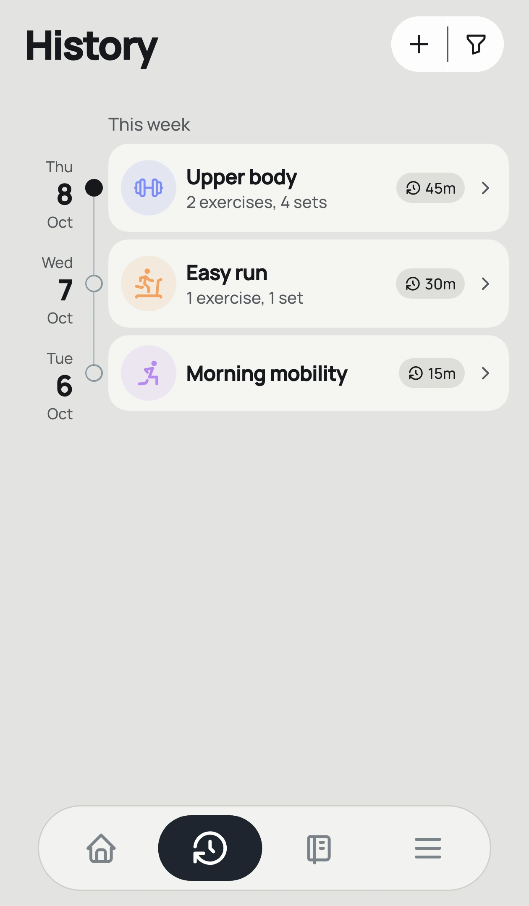 | 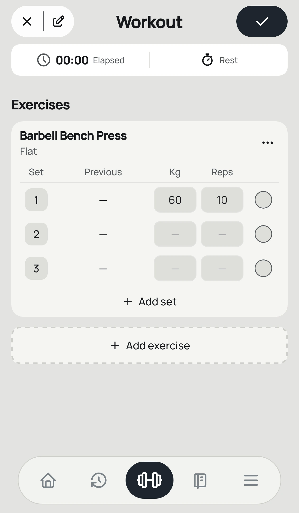 |

| Plans                                                                                       | Workout details                                                                                                 | Exercise library                                                                                           |
| ------------------------------------------------------------------------------------------- | --------------------------------------------------------------------------------------------------------------- | ---------------------------------------------------------------------------------------------------------- |
| 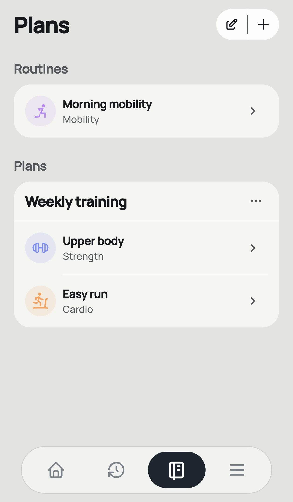 | 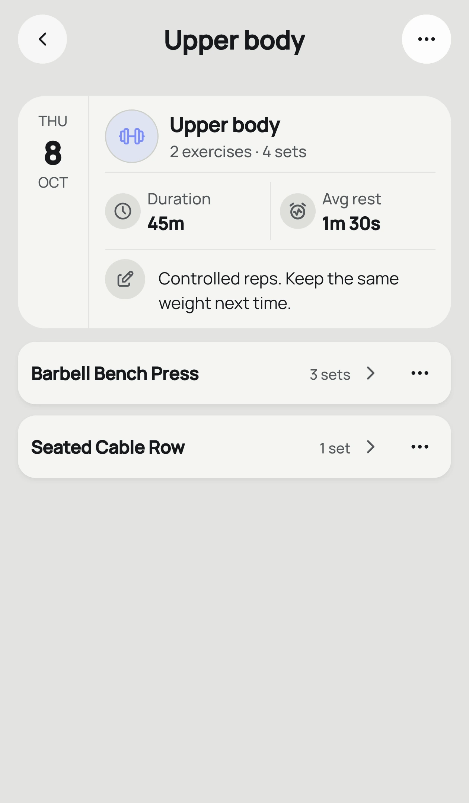 | 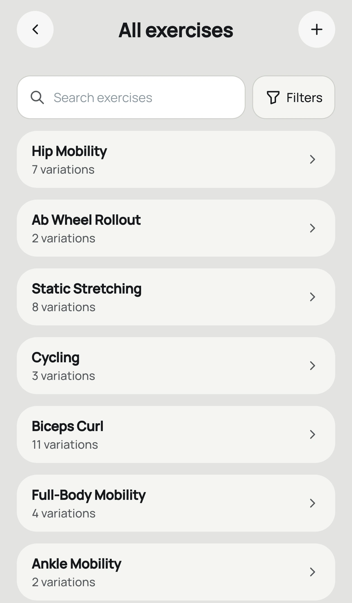 |

</details>

<sub>Preview captures use fictional sample workouts and browser rendering. These are not native-device screenshots.</sub>

## Data and privacy

Forge stores training data in a local SQLite database on your device. Forge has no account system, cloud sync, advertising SDK or analytics SDK. Imports and exports are initiated by you.

Use **Settings → Backup & Export** to create a portable backup. Full SQLite backup and restore are available in native builds. The same area contains **Import from another app** and **Delete all app data**.

> [!IMPORTANT]
> Keep backups outside the app. Uninstalling Forge or deleting app data can remove your local journal.

## Native development

You need Node.js **22.13 or newer** and npm. Clone the repository and install dependencies:

```sh
npm ci
```

Use a development build containing Forge's local native module. Start Metro with `npm start`, or use `npm run ios` / `npm run android` to start Expo for the respective platform. Expo Go does not contain Forge's custom native functionality.

Local iOS builds require macOS, Xcode and CocoaPods; Android builds require the Android SDK and JDK. Follow the platform workflows below for the project's toolchain setup and compatibility steps.

## Check changes

Run `nice -n 10 npm run typecheck` and the automated tests directly affected by your change. See [the test guide](tests/README.md) for coverage and commands. Use up to two-thirds of available CPU cores, run one resource-heavy suite at a time, and preserve memory headroom.

Verify native keyboards, file access, SQLite persistence and rest-timer integrations on iOS and Android devices. Automated checks do not replace device verification.

## Native test builds

Manual workflows in GitHub Actions generate device builds without using EAS build quota:

| Platform | Workflow                                                  | Download artifact        | Distribution                                                                           |
| -------- | --------------------------------------------------------- | ------------------------ | -------------------------------------------------------------------------------------- |
| iOS      | [Build unsigned iOS IPA](.github/workflows/build-ipa.yml) | `Forge-unsigned-ios-ipa` | Unsigned IPA; requires signing before installation. The app targets iOS 16.4 or newer. |
| Android  | [Build Android APK](.github/workflows/build-apk.yml)      | `Forge-android-apk`      | ARM64 APK signed with a debug key, for testing on compatible devices.                  |

Choose the workflow in **Actions → Run workflow**, select the branch, and download the artifact when it finishes. These workflows upload artifacts to the workflow run, rather than publishing GitHub Releases.

For iOS sideloading, I recommend [iLoader](https://github.com/nab138/iloader). Download it from the official repository or [iloader.app](https://iloader.app/), extract the workflow artifact, then import the unsigned `.ipa` and follow iLoader's device and Apple Account prompts. iLoader handles signing for installation; the downloaded IPA itself is unsigned.

> [!NOTE]
> These artifacts are test builds. TestFlight and store distribution require appropriate distribution signing and provisioning; the unsigned IPA cannot be uploaded directly to TestFlight.

## Working in the repository

| Location                                        | Purpose                                                          |
| ----------------------------------------------- | ---------------------------------------------------------------- |
| `src/screens/`, `src/components/`, `src/theme/` | Screens, shared Forge controls and visual tokens                 |
| `src/domain/`                                   | Training and exercise logic independent of UI and storage        |
| `src/data/`, `src/state/`                       | Repositories, transfer/import logic and React providers          |
| `src/navigation/`                               | React Navigation stacks, tabs and opened-file routing            |
| `modules/forge-rest-timer/`, `plugins/`         | Native rest timers, iOS numeric keyboard and Expo config plugins |
| `tests/`                                        | Automated checks, fixtures and visual baselines                  |
| `data/catalog/`, `scripts/`                     | Exercise source data and catalogue tooling                       |

`npm run catalog:audit` checks catalogue variations and classifications.

For repository maintenance, start with [AGENTS.md](AGENTS.md). It routes to the active rules and accepted product requirements under `.agents/`; research and audit documents are advisory. The project uses the [GNU GPL v3 or later](LICENSE).
